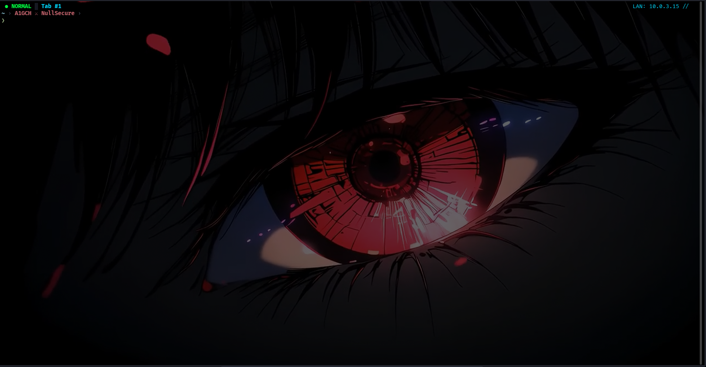

# NullSecure terminal setup

A dark, red-team style terminal: **Starship** prompt, a heavily customised **Zellij** status bar, and an **animated wallpaper** (xwinwrap + mpv at 10 FPS so it stays light on the CPU).



## What you get

| Piece | What it does |
|---|---|
| **Starship** prompt | `~ › <your name> ⚔ <second name> ›` — the names are asked by the installer. Also shows `⚡ N sessions` while `msfconsole` is running (N = number of running `msfconsole` processes). |
| **Zellij** layout `void-samurai` | Top bar with mode badge, tabs and key hints on the left. On the right: **TGT** (your current target), **LPORT** (common listener ports in use: 80, 443, 4444, 8000, 8080, 8443, 9001) and **network** (`TUN0` VPN IP, or `LAN` IP, or `OFFLINE`). |
| Zellij plugins | `zjstatus`, `zjstatus-hints`, `room`, `zellij_forgot`, `zellij-pane-picker`, `zellij-autolock` (bundled in `zellij/plugins/`). |
| `.zshrc` helpers | `addtarget`, `rmtarget`, `cleartarget` — set a target IP from `/etc/hosts` and see it in the Zellij bar. |
| Animated wallpaper | `xwinwrap` + `mpv` playing a video loop behind your terminal, started automatically at login (XFCE). |

## Requirements

- Debian-based Linux (Kali, Debian, Ubuntu…) with **zsh**. The installer uses `apt`.
- **XFCE on X11** for the animated wallpaper (`xwinwrap` does not work on Wayland). Check with `echo $XDG_CURRENT_DESKTOP $XDG_SESSION_TYPE`.
- A terminal with a **transparent background** (see [Terminal transparency](#terminal-transparency)).

The installer checks for and installs everything else: `mpv`, `xclip`, `git`, `curl`, `iproute2`, `zsh`, `xwinwrap` (built from source), `zellij` and `starship`.

## Install

```bash
git clone https://github.com/<your-user>/<this-repo>.git
cd <this-repo>
bash install.sh
```

The installer asks you for:

1. **Your name(s)** for the Starship prompt (the second one is optional).
2. **Path to a wallpaper video** (press Enter to skip the animated wallpaper).

Then it installs missing packages (it asks before using `sudo apt`), copies the configs, adds a block to `~/.zshrc`, and creates the wallpaper autostart entry. Open a **new terminal** when it finishes.

Non-interactive example:

```bash
bash install.sh --yes --name1 Ahmad --name2 "My Brand" --video ~/Videos/loop_10fps.mp4
```

| Option | Meaning |
|---|---|
| `--name1 NAME` / `--name2 NAME` | Names for the prompt. Max 30 characters; the characters [ ] ( ) $ " ` \ are not allowed. |
| `--video PATH` | Wallpaper video file. |
| `--no-wallpaper` | Skip `mpv`/`xwinwrap` and the autostart entry. |
| `--grant-permissions` | Only write the Zellij plugin permissions (see Troubleshooting), then exit. |
| `-y`, `--yes` | Don't ask questions. |

Re-running is safe: anything it replaces is saved next to the original as `*.bak-<timestamp>`.

### What gets installed where

| From this repo | To |
|---|---|
| `zellij/` | `~/.config/zellij/` |
| *(generated)* plugin permissions, so Zellij doesn't ask "Allow? (y/n)" | `~/.cache/zellij/permissions.kdl` (merged with what is already there) |
| `starship/starship.toml` (with your name filled in) | `~/.config/starship.toml` |
| `zsh/zshrc.snippet` | a managed block inside `~/.zshrc` (between the `nullsecure-dotfiles` markers) |
| `wallpaper/live-wallpaper.desktop` (with your video path) | `~/.config/autostart/safe-live-wallpaper.desktop` |

## The wallpaper

The video itself is **not** included in this repo — bring any short, dark, seamless loop (mp4).

Convert it to 10 FPS first so playback is cheap:

```bash
ffmpeg -i input.mp4 -an -vf fps=10 -c:v libx264 -crf 28 -preset slow loop_10fps.mp4
```

The autostart entry runs:

```bash
xwinwrap -ni -fs -s -st -sp -nf -b -un -- \
  mpv -wid WID --loop --no-audio --profile=fast --vo=x11 --hwdec=no \
  --vf=fps=10 --keepaspect-window=no --panscan=1.0 /path/to/loop_10fps.mp4
```

`--vf=fps=10` makes sure mpv never renders more than 10 frames per second, `--no-audio` and `--profile=fast` keep it light, and `--panscan=1.0` fills the whole screen.

- **Stop it:** `pkill xwinwrap` (and `pkill -f "mpv -wid"` if a player is left behind).
- **Disable permanently:** delete `~/.config/autostart/safe-live-wallpaper.desktop`.
- **Start it without logging out:** run the `Exec=` line from that file in a terminal.

### Terminal transparency

The wallpaper sits *behind* your windows, so the terminal has to let it show through:

1. XFCE compositor on: **Settings → Window Manager Tweaks → Compositor → Enable display compositing**.
2. Terminal background transparent:
   - **QTerminal** (default on Kali): **Preferences → Appearance → Terminal transparency** (slide it to the level you like).
   - **xfce4-terminal**: **Edit → Preferences → Appearance → Background → Transparent background**.
   - Other terminals (kitty, alacritty…) have an equivalent "background opacity" setting.

## Handy Zellij keys

| Key | Action |
|---|---|
| `Alt h / j / k / l` (or arrows) | Move focus between panes / tabs |
| `Alt [` / `Alt ]` | Previous / next swap layout |
| `Ctrl f` | Searchable key-binding cheat sheet (`zellij_forgot`) |
| `Ctrl y` | Quick tab switcher (`room`) |
| `Alt y` | Pane picker (`zellij-pane-picker`) |
| `Alt p` | Add / remove pane from a group |
| `Ctrl p / n / s / o / t / h / b` | Pane / Resize / Scroll / Session / Tab / Move / Tmux mode |

`zellij-autolock` locks Zellij automatically while you are inside `nvim`, `vim`, `nano`, `fzf`, `zoxide` or `sudo`, so those programs get your keys.

Everything is in `zellij/config.kdl` — change what you like.

## Target helpers

```bash
echo "10.10.10.5 rootme.thm" | sudo tee -a /etc/hosts   # one-time
addtarget rootme.thm        # sets ROOTME_THM=10.10.10.5 and shows it in the Zellij bar
nmap -sC -sV $ROOTME_THM
rmtarget rootme.thm         # remove one
cleartarget                 # remove all
```

`addtarget` has tab-completion from `/etc/hosts`. The current targets are stored in `/tmp/target`.

## Zellij version

These configs and the bundled plugins (`.wasm`) work with **Zellij 0.44.1**. Newer and older releases can give errors, because plugins are tied to the Zellij release they were built for.

- If Zellij is not installed, the installer downloads **0.44.1** into `~/.local/bin`.
- If a different version is installed, the installer asks before putting **0.44.1** into `~/.local/bin` (that folder comes first in `PATH`, so it wins; your old `~/.local/bin/zellij`, if any, is saved as `zellij.bak-<timestamp>`).
- If 0.44.1 is already installed, nothing is downloaded.
- To use another release anyway: `ZELLIJ_VERSION=x.y.z bash install.sh`, or `ZELLIJ_VERSION=latest bash install.sh` for the newest one (and to keep whatever is installed).
- If a plugin fails to load, check `zellij --version` and `which zellij`; if it isn't 0.44.1, run `bash install.sh` again and accept the install.

## Troubleshooting

- **Blank top bar, the terminal looks frozen, and the window title shows `…/.config/zellij/plugins/zjstatus.wasm`:** Zellij is waiting for you to answer its "Allow? (y/n)" permission question for a plugin. The bar is only one line tall, so the question is invisible and the keyboard focus is stuck on it. The installer now grants these permissions for you (it writes `~/.cache/zellij/permissions.kdl`). If you still hit it (config copied by hand, cache deleted…), open another terminal and run:

  ```bash
  bash install.sh --grant-permissions     # only writes the permissions, nothing else
  zellij kill-all-sessions -y             # close the stuck session
  ```

  then open a new terminal. (Emergency exit from the stuck screen: press `y` a few times, once per plugin.)
- **No wallpaper:** check `pgrep xwinwrap`, make sure you are on X11 (not Wayland), the compositor is on, and the terminal background is transparent.
- **High CPU:** make sure the video is already 10 FPS (see above). A static image is the lightest option.
- **Prompt shows `[ ]` boxes for `⚔` / `⚡`:** your terminal font lacks those symbols — pick a font with broad Unicode coverage (e.g. DejaVu Sans Mono) or add a fallback font.
- **A random string like `26661nChgK…==` shows up after the prompt when Zellij starts (seen in QTerminal):** Zellij 0.45+ sends a private DCS escape sequence (`ESC P 26661 n <base64> ESC \`) that carries the session name; it is part of the nested-sessions feature. Terminals are supposed to ignore unknown DCS sequences, but QTerminal prints it instead. It is cosmetic and disappears on the next redraw (click in the window). To avoid it, use a terminal that ignores the sequence (e.g. `xfce4-terminal`, kitty, alacritty).
- **Nothing changes in the shell:** the config lives in `~/.zshrc`. Switch your login shell with `chsh -s "$(command -v zsh)"` and open a new terminal.
- **Zellij shows no TGT / LPORT / network:** the status bar runs `~/.config/zellij/scripts/zj-*.sh`. They are symlinks to `sysload.sh`; re-run `bash install.sh` to recreate them.

## Uninstall

```bash
pkill xwinwrap
rm ~/.config/autostart/safe-live-wallpaper.desktop
# restore your old files from the *.bak-<timestamp> copies, e.g.:
#   ~/.config/zellij.bak-*   ~/.config/starship.toml.bak-*   ~/.zshrc.bak-*
# or just delete the "nullsecure-dotfiles" block from ~/.zshrc
```

## Credits

Made by **NullSecure**. The Zellij plugins in `zellij/plugins/` belong to their respective authors — check each project's license before redistributing.
